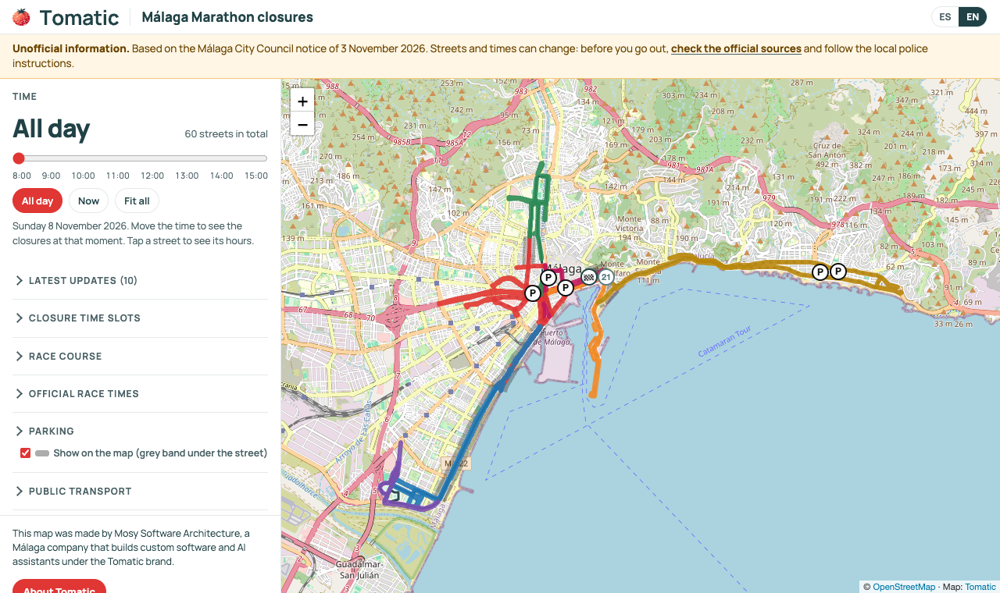

# event-closures-map

Una página web estática que muestra en un mapa los cortes de tráfico de un evento: una maratón,
un desfile, una carrera ciclista, unas fiestas. La gente mueve la hora y ve qué calles están
cortadas en ese momento, dónde no se puede aparcar, por dónde pasa el recorrido y qué ha cambiado
a última hora.

Todo lo que muestra la página sale de unos pocos ficheros JSON. Puedes editarlos a mano o dejar que
un agente de IA los construya contigo a partir del aviso oficial (ver [AGENTS.md](AGENTS.md)).

[Read in English](README.md)



Nació para la Generali Maratón de Málaga 2026
([en vivo](https://cortes-trafico-maraton-malaga.tomatic.ai/)); esos datos vienen como ejemplo en
[`examples/malaga-marathon-2026`](examples/malaga-marathon-2026).

## Qué incluye

- Calles coloreadas por franja horaria de corte, un deslizador de hora y un botón «ahora» (en la zona horaria del evento).
- Ventanas con el horario y las notas de cada calle; los cortes parciales o dudosos se señalan en vez de suponerse.
- Prohibiciones de aparcar (banda gris bajo la calle) y aparcamientos con acceso limitado.
- El recorrido, marcado como «no es un corte», con iconos a lo largo, desde el GPX oficial.
- Un bloque de «última hora» que lee un JSON que otro proceso puede reescribir sin recompilar.
- Fuentes oficiales, aviso legal y un aviso plegable de «información no oficial».
- Los idiomas que quieras (español e inglés de serie), según el navegador o `?lang=`.
- Funciona en el móvil; tema claro y oscuro; sin cookies ni analítica.
- Tu logo, título, subtítulo, colores, tipografía y llamada a la acción, todo desde `branding.json`.
- Política de seguridad de contenidos estricta, integridad de subrecursos para Leaflet y HSTS.
- Solo Node 22: sin framework y sin `npm install`.

## Empezar

```sh
git clone https://github.com/Mosy-Software-Architecture/event-closures-map.git
cd event-closures-map
npm run example        # los datos de Málaga en http://127.0.0.1:5173/
npm run dev            # tu evento, desde data/
```

`data/` trae solo `event.json` y `branding.json`: con ellos la página ya funciona y muestra el mapa
vacío de la zona. El resto se añade sobre la marcha. El servidor de desarrollo regenera la página
en cada petición, recarga el navegador al cambiar un fichero y escribe los errores de validación en
la terminal.

## Los ficheros de datos

Todos viven en una carpeta (`data/` por defecto; otra con `--data <dir>`). Cada uno tiene su JSON
Schema en [`schemas/`](schemas); los editores que entienden `$schema` los autocompletan.

| Fichero | Obligatorio | Qué lleva |
|---|---|---|
| `event.json` | sí | Nombre, ciudad, fecha, zona horaria, idiomas, ventana del deslizador, centro y límites del mapa, el aviso, secciones libres de información (horarios de la prueba, transporte...), SEO y despliegue. |
| `branding.json` | sí | Nombre de la organización, logo (claro y oscuro), título, subtítulo, colores, tipografía, llamada a la acción, aviso legal y crédito del pie. |
| `closures.json` | no | Franjas horarias (`bands`) y calles cortadas, cada una con sus franjas, notas y geometría GeoJSON. |
| `parking.json` | no | Prohibiciones de aparcar (con o sin geometría) y aparcamientos con acceso limitado. |
| `routes.json` | no | Los recorridos y marcadores como la salida y la meta. |
| `sources.json` | no | Fuentes oficiales; la que lleva `"primary": true` es la que enlaza el aviso. |
| `updates.json` | no | Última hora. Mismo formato que el fichero publicado, así que se puede sustituir en vivo. |
| `i18n.json` | no | Cambios a cualquier texto de la interfaz, por idioma (claves en [`src/strings.js`](src/strings.js)). |
| `assets/` | no | El logo y la imagen para redes. |

Convenciones comunes:

- **Texto traducible**: una cadena o un objeto con una cadena por idioma:
  `{"es": "Calle cortada", "en": "Closed street"}`. El primer idioma de `event.languages` es el de por defecto.
- **Texto enriquecido** (aviso, información, notas, aviso legal): admite `**negrita**` y
  `[texto](https://enlace)`. Nada más se interpreta: la página nunca inserta HTML de los datos.
- **Coordenadas** en orden GeoJSON, `[lon, lat]`, salvo `center` y la vista de la imagen para redes,
  que van en orden Leaflet, `[lat, lon]`. El validador detecta un par al revés porque cae fuera de los límites.
- **Horas**: hora local del día del evento, `"9:15"` o `"09:15"`.
- **Enlaces**: siempre `https://`.

### Un corte mínimo

```json
{
  "bands": [{ "id": "A", "from": "08:15", "to": "12:30", "color": "#e03634" }],
  "streets": [{ "id": "alameda", "name": "Alameda Principal", "bands": ["A"] }]
}
```

Con `npm run fetch-streets` la calle recibe su geometría de OpenStreetMap. Una calle cortada en dos
franjas lleva las dos (`"bands": ["A", "G"]`); la segunda se pinta discontinua.

## Comandos

| Comando | Qué hace |
|---|---|
| `npm run dev` | Sirve la página desde `src/` y la carpeta de datos, con recarga automática. |
| `npm run validate` | Esquemas y comprobaciones cruzadas: franjas que no existen, colores repetidos, enlaces sin https, geometría fuera de los límites, traducciones que faltan. Sale con código 1 si hay errores. |
| `npm run fetch-streets` | De nombres de calle a geometría de OpenStreetMap vía Overpass. Lista las calles no encontradas y los nombres que aparecen en sitios alejados. Nunca se inventa una línea. |
| `npm run gpx-to-routes -- fichero.gpx --id marathon` | Convierte un track GPX en un recorrido simplificado en `routes.json`. |
| `npm run build` | Escribe `dist/public` (el sitio) y `dist/firebase.json` (configuración del hosting con cabeceras de seguridad). No compila si hay errores de validación. |
| `npm run preview` | Sirve `dist/` con las cabeceras de producción. |
| `npm run og` | Hace la imagen para redes (1200x630) a partir de la propia página (necesita Chrome). |
| `npm run deploy` | Compila y publica en Firebase Hosting, conservando la última hora publicada. |
| `npm test` | Pruebas unitarias (esquemas, validación, Overpass con una respuesta grabada, GPX, build, vigilante). |
| `npm run smoke` | Carga `dist/` en Chrome sin ventana a tamaño escritorio y móvil, y falla si hay errores de consola, violaciones de la CSP o el mapa sale vacío (necesita Chrome; `CHROME_PATH` para indicar dónde). |

Todos aceptan `--data <dir>` o la variable de entorno `ECM_DATA`.

### fetch-streets en detalle

Para cada calle sin geometría busca vías de OpenStreetMap dentro de los límites del evento cuyo
nombre coincida. Por defecto el patrón es el nombre exacto con las tildes opcionales; con `osm`
se afina:

```json
"osm": {
  "match": "^Paseo (Marítimo )?(de )?Antonio Machado$",
  "bbox": [-4.52, 36.66, -4.40, 36.76],
  "ways": [35842037, 183755703],
  "anyTag": true,
  "includeFootways": true,
  "as": "polygon"
}
```

- `match`: expresión regular sin distinguir mayúsculas sobre el nombre en OSM (sintaxis POSIX: también la ejecuta Overpass).
- `bbox`: acota la búsqueda cuando el mismo nombre existe en otro punto de la zona.
- `ways`: identificadores de vías de OSM, para puentes sin nombre o tramos que no lo comparten.
- `anyTag`: incluye vías sin etiqueta `highway` (diques, muelles).
- `includeFootways`: las aceras, escaleras y caminos se descartan salvo que lo indiques.
- `as: "polygon"`: plazas y edificios como áreas.

Escribe la geometría y `osm.resolved` (las vías usadas) en el propio fichero. Las respuestas se
guardan en `.cache/overpass/`; `--no-cache` vuelve a preguntar, `--force` repite las calles que ya
tienen geometría, `--only id,id` limita la ejecución y `--dry-run` no escribe nada. `OVERPASS_URL`
permite usar otra instancia de Overpass.

## Publicar

`npm run build` genera un sitio estático en `dist/public`. Vale cualquier hosting estático; lo
único que hay que trasladar son las cabeceras de `dist/firebase.json` (CSP, HSTS, X-Frame-Options...).

**Firebase Hosting** viene integrado. Pon `event.site.firebase` a `{ "site": "...", "project": "..." }`,
inicia sesión con `firebase login` o con credenciales de aplicación (ADC) y ejecuta `npm run deploy`.

**Última hora.** Durante el evento, `updates.json` suele reescribirlo otro (una persona o el
vigilante de abajo). Un despliegue sustituye el sitio entero, así que `npm run deploy` descarga
antes el fichero publicado y publica ese; si no puede leerlo, se para. En otros hostings, hazlo a
mano antes de subir.

**Buscadores.** Con `event.site.url`, el build escribe la URL canónica, los enlaces hreflang, las
etiquetas Open Graph y de Twitter, datos de schema.org, `robots.txt` y `sitemap.xml`, además de una
lista rastreable de las calles cortadas. `"noindex": true` deja una copia de pruebas fuera de los buscadores.

## Vigilante de última hora (opcional)

[`watch-updates/`](watch-updates) ejecuta un agente sin interfaz (`claude -p`, con búsqueda web y
nada más) con un temporizador durante el evento. Busca noticias, el script valida cada una (enlace
https en dominios permitidos, todos los idiomas, sin marcado, sin repetidas) y publica solo el
fichero de novedades. Ver su [README](watch-updates/README.md).

## Seguridad

- Sin cookies, sin analítica y sin scripts de terceros salvo Leaflet (versión fija con SRI).
- `script-src 'self' https://unpkg.com`: sin scripts en línea. Los datos se pintan con
  `textContent`; el texto enriquecido se convierte en nodos y solo sobreviven los enlaces `https://`.
- El build escapa todo lo que escribe en el HTML; las pruebas lo comprueban.
- El agente del vigilante no tiene herramientas de ficheros ni de terminal, su respuesta se trata
  como entrada no fiable y nunca ve las credenciales.

## Contribuir

Ver [CONTRIBUTING.md](CONTRIBUTING.md). Las incidencias y las pull requests son bienvenidas.

## Licencia y atribución

Código: [Apache License 2.0](LICENSE). Conserva el fichero [NOTICE](NOTICE) al redistribuirlo.

Datos del mapa © colaboradores de [OpenStreetMap](https://www.openstreetmap.org/copyright), con
licencia Open Database License. La página muestra esa atribución en el mapa y en los enlaces
legales; mantenla. Las teselas vienen de openstreetmap.org: con mucho tráfico, revisa su
[política de uso](https://operations.osmfoundation.org/policies/tiles/) y plantéate otro proveedor.

El pie dice «Hecho con event-closures-map de Tomatic». Puedes quitarlo con `"credit": false` en
`branding.json`, pero te agradeceremos que lo dejes.

Hecho en Málaga por [Tomatic](https://tomatic.ai/?utm_source=github&utm_medium=referral&utm_campaign=event-closures-map),
la marca con la que MOSY SOFTWARE ARCHITECTURE SL desarrolla software y asistentes de IA a medida.
