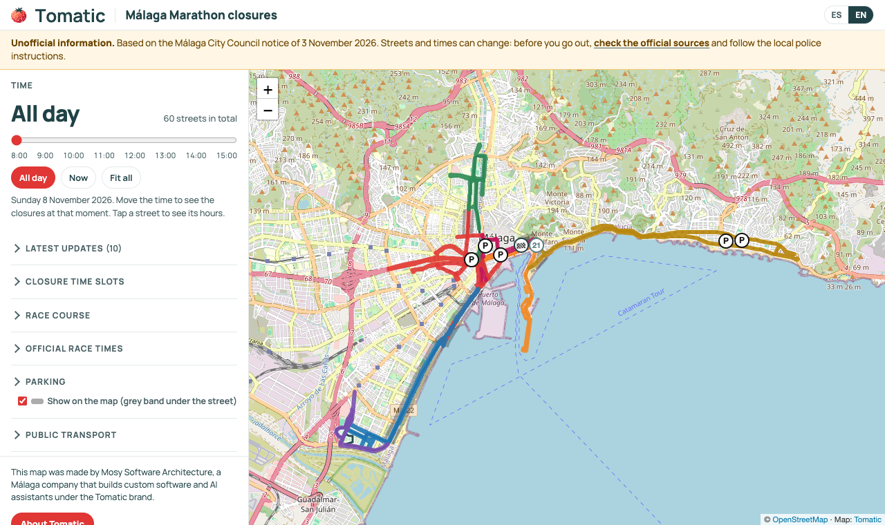

# event-closures-map

A static web page that shows the road closures of one event on a map: a marathon, a parade, a
cycling race, a festival. People move a time slider and see which streets are closed at that
moment, where they cannot park, where the course goes and what changed at the last minute.

Everything the page shows comes from a few JSON files. You can edit them by hand, or let an AI
agent build them with you from the official notice (see [AGENTS.md](AGENTS.md)).

[Leer en español](README.es.md)



It was first built for the Generali Maratón de Málaga 2026
([live](https://cortes-trafico-maraton-malaga.tomatic.ai/)); that dataset ships as the example in
[`examples/malaga-marathon-2026`](examples/malaga-marathon-2026).

## What you get

- Streets coloured by closure time slot, a time slider and a "now" button (in the event's time zone).
- Popups with the hours and notes of each street; partial or uncertain closures flagged instead of guessed.
- Parking bans (grey band under the street) and car parks with restricted access.
- The course, drawn as "not a closure", with markers along it, from the official GPX.
- A "latest updates" block that reads a JSON file another process can rewrite without a rebuild.
- Official sources, a legal notice and a collapsible "unofficial information" banner.
- Any number of languages (Spanish and English built in), chosen from the browser or `?lang=`.
- Works on phones; light and dark themes; no cookies and no analytics.
- Your logo, title, subtitle, colours, font and call to action, all from `branding.json`.
- A strict Content Security Policy, Subresource Integrity on Leaflet, and HSTS.
- Node 22 and nothing else: no framework, no `npm install`.

## Quick start

```sh
git clone https://github.com/Mosy-Software-Architecture/event-closures-map.git
cd event-closures-map
npm run example        # the Málaga dataset on http://127.0.0.1:5173/
npm run dev            # your event, from data/
```

`data/` starts with only `event.json` and `branding.json`: the page already works with them and
shows an empty map of the area. Add the rest as you go. The dev server rebuilds on every request,
reloads the browser when a file changes and prints validation errors in the terminal.

## The data files

All of them live in one folder (`data/` by default; any other with `--data <dir>`). Each one has a
JSON Schema in [`schemas/`](schemas); editors that understand `$schema` will autocomplete them.

| File | Required | What it holds |
|---|---|---|
| `event.json` | yes | Name, city, date, time zone, languages, slider window, map centre and bounding box, the notice, free-form info sections (race times, public transport...), SEO and deploy settings. |
| `branding.json` | yes | Organisation name, logo (light and dark), title, subtitle, colours, font, call to action, legal notice, footer credit. |
| `closures.json` | no | Time slots (`bands`) and the closed streets, each with its slots, notes and GeoJSON geometry. |
| `parking.json` | no | Parking bans (with or without geometry) and car parks with restricted access. |
| `routes.json` | no | The course lines and markers such as start and finish. |
| `sources.json` | no | Official sources; the one with `"primary": true` is linked from the notice. |
| `updates.json` | no | Latest updates. Same contract as the published file, so it can be replaced live. |
| `i18n.json` | no | Overrides of any interface text, per language (keys in [`src/strings.js`](src/strings.js)). |
| `assets/` | no | Logo files and the social preview image. |
| `public/` | no | Copied as is to the site root (verification files, images for social posts). Generated files win on a name clash. |

Conventions that apply everywhere:

- **Localized text** is either a string or an object with one string per language:
  `{"es": "Calle cortada", "en": "Closed street"}`. The first language in `event.languages` is the default.
- **Rich text** (notice, info items, notes, legal paragraphs) accepts `**bold**` and
  `[text](https://link)`. Nothing else is interpreted: the page never inserts HTML from the data.
- **Coordinates** follow GeoJSON, `[lon, lat]`, except `center` and the OG view, which follow
  Leaflet, `[lat, lon]`. The validator catches a swapped pair because it falls outside the bbox.
- **Times** are local times of the event day, `"9:15"` or `"09:15"`.
- **URLs** must be `https://`.

### A minimal closure

```json
{
  "bands": [{ "id": "A", "from": "08:15", "to": "12:30", "color": "#e03634" }],
  "streets": [{ "id": "alameda", "name": "Alameda Principal", "bands": ["A"] }]
}
```

Run `npm run fetch-streets` and the street gets its geometry from OpenStreetMap. A street in two
slots lists both (`"bands": ["A", "G"]`); the second one is drawn dashed.

## Scripts

| Command | What it does |
|---|---|
| `npm run dev` | Serves the page from `src/` and the data folder, with live reload. |
| `npm run validate` | Schemas plus cross-checks: unknown slots, repeated colours, non-https links, geometry outside the bbox, missing translations. Exit code 1 on errors. |
| `npm run fetch-streets` | Street names to OpenStreetMap geometry through Overpass. Lists streets not found and names that match places far apart. Never invents a line. |
| `npm run gpx-to-routes -- file.gpx --id marathon` | Turns a GPX track into a simplified course in `routes.json`. |
| `npm run build` | Writes `dist/public` (the site) and `dist/firebase.json` (hosting config with security headers). Refuses to build with validation errors. |
| `npm run preview` | Serves `dist/` with the production headers. |
| `npm run og` | Takes the 1200x630 social preview image from the page itself (needs Chrome). |
| `npm run deploy` | Builds and publishes to Firebase Hosting, keeping the live updates file. |
| `npm test` | Unit tests (schemas, validation, Overpass resolution with a recorded response, GPX, build, watcher). |
| `npm run smoke` | Loads `dist/` in headless Chrome at desktop and phone sizes and fails on console errors, CSP violations or an empty map (needs Chrome; `CHROME_PATH` to point at it). |

Every script takes `--data <dir>`, or the `ECM_DATA` environment variable.

### fetch-streets in detail

For each street without geometry it searches OpenStreetMap ways inside the event bbox whose name
matches. By default the pattern is the exact name with accents optional; set `osm` to steer it:

```json
"osm": {
  "match": "^Paseo (Marítimo )?(de )?Antonio Machado$",
  "bbox": [-4.52, 36.66, -4.40, 36.76],
  "ways": [35842037, 183755703],
  "anyTag": true,
  "includeFootways": true,
  "as": "polygon"
}
```

- `match`: case-insensitive regular expression on the OSM name (POSIX syntax: Overpass runs it too).
- `bbox`: narrows the search when the same name exists elsewhere in the area.
- `ways`: explicit OSM way ids, for bridges without a name or pieces that do not share it.
- `anyTag`: also ways without a `highway` tag (piers, breakwaters).
- `includeFootways`: footways, steps and paths are skipped unless this is set.
- `as: "polygon"`: squares and buildings drawn as areas.

It writes the geometry and `osm.resolved` (the way ids used) back into the file. Responses are
cached in `.cache/overpass/`; `--no-cache` asks again, `--force` refetches streets that already
have geometry, `--only id,id` limits the run, `--dry-run` writes nothing. Set `OVERPASS_URL` to use
another Overpass instance.

## Deploying

`npm run build` produces a plain static site in `dist/public`. Any static host works; the only
things to carry over are the response headers in `dist/firebase.json` (CSP, HSTS,
X-Frame-Options...).

**Firebase Hosting** is built in. Set `event.site.firebase` to `{ "site": "...", "project": "..." }`
(or the `FIREBASE_SITE` and `FIREBASE_PROJECT` environment variables), sign in with `firebase login`
or Application Default Credentials, and run `npm run deploy`. It runs a pinned firebase-tools version.

**Latest updates.** `updates.json` is usually rewritten by someone else while the event runs (a
person, or the watcher below). A deploy replaces the whole site, so `npm run deploy` downloads the
live file first and publishes that one; if it cannot read it, it stops. On other hosts, do the same
by hand before uploading.

**Search engines.** With `event.site.url` set, the build writes the canonical URL, hreflang links,
Open Graph and Twitter tags, schema.org data, `robots.txt` and `sitemap.xml`, plus a crawlable list
of the closed streets. `"noindex": true` keeps a test copy out of search results.

## Latest-updates watcher (optional)

[`watch-updates/`](watch-updates) runs a headless agent (`claude -p`, with web search and nothing
else) on a timer during the event. It looks for news, the script validates every item (https link
on an allowlist of domains, every language, no markup, no repeats) and publishes only the updates
file. See its [README](watch-updates/README.md).

## Security

- No cookies, no analytics, no third-party scripts besides Leaflet (pinned version with SRI).
- No `unsafe-inline` anywhere in the CSP: scripts come from the site and the pinned Leaflet file only,
  and the one inline style (brand colours) is allowed by its hash. Data is rendered with
  `textContent`; the rich-text syntax is parsed into DOM nodes and only plain `https://` links survive
  (no user info, ports or backslashes).
- The build escapes everything it writes into the HTML; the tests check it.
- The watcher's agent only has web search and fetch (no MCP servers, no user settings, a clean
  environment), its answer is treated as untrusted input, and the credentials never reach it. Items
  from domains marked `review` wait for a person instead of being published.

## Contributing

See [CONTRIBUTING.md](CONTRIBUTING.md). Issues and pull requests are welcome.

## License and attribution

Code: [Apache License 2.0](LICENSE). Keep the [NOTICE](NOTICE) file when you redistribute it.

Map data © [OpenStreetMap](https://www.openstreetmap.org/copyright) contributors, under the Open
Database License. The page shows this attribution on the map and in the legal links; keep it.
Map tiles come from openstreetmap.org: for heavy traffic, read their
[tile usage policy](https://operations.osmfoundation.org/policies/tiles/) and consider another provider.

The footer says "Built with event-closures-map by Tomatic". You can turn it off with
`"credit": false` in `branding.json`, but we would be grateful if you kept it.

Made in Málaga by [Tomatic](https://tomatic.ai/?utm_source=github&utm_medium=referral&utm_campaign=event-closures-map),
the brand under which MOSY SOFTWARE ARCHITECTURE SL builds custom software and AI assistants.
